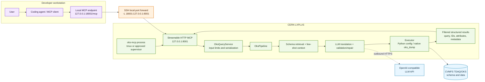

# OKS MCP System Architecture

This document describes the deployed path for natural-language OKS queries.
The companion visual is [system_architecture.png](system_architecture.png).
The checked-in SVG/PNG keeps labels exact; the reusable AI-generation prompt
for a stylistic variant is in
[system_architecture_image_prompt.md](system_architecture_image_prompt.md).

## Runtime responsibilities

| Boundary | Responsibility |
| --- | --- |
| Coding agent | Maintains conversation memory and turns follow-ups into complete questions. |
| SSH tunnel | Provides private access from the workstation to the CERN loopback port. |
| MCP server | Exposes `oks_query`, `oks_translate`, and `oks_environment_probe`. |
| Service/pipeline | Validates inputs, retrieves a small schema slice, translates natural language, validates the OksQuery, and coordinates execution. |
| Executor | Filters the OKS configuration through Python `config` or native `oks_dump`; it does not send the full configuration to the agent. |
| CERN runtime | Supplies the selected TDAQ release, CVMFS schema, and approved OKS data file. |

## Request sequence

1. The user asks a natural-language question in the coding agent.
2. The agent calls the MCP endpoint through the SSH local forward.
3. The service retrieves only the relevant schema and few-shot examples.
4. The configured LLM generates an OksQuery; validation and repair run before execution.
5. The OKS engine returns only matching objects and selected attributes.
6. The MCP response returns the generated query, result count, filtered objects, version metadata, and warnings.
7. The agent explains the result and owns any follow-up context.

## Security and state model

- The server binds to `127.0.0.1:8001` on CERN; it is not a public listener.
- The workstation endpoint `127.0.0.1:18001` exists only while the SSH tunnel is connected.
- The MCP layer is stateless. No conversation database is required for the first deployment.
- No arbitrary shell command, data-file path, or raw unvalidated OksQuery is exposed as an MCP tool.
- Public exposure requires authentication, authorization, TLS/reverse-proxy policy, rate limits, logging, and an approved long-running service owner.
