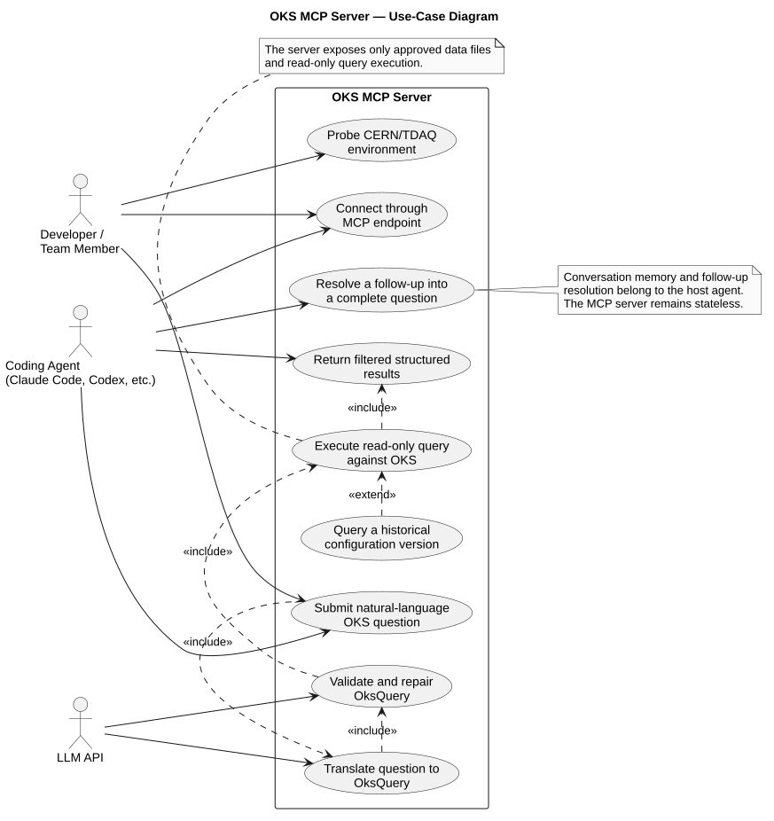
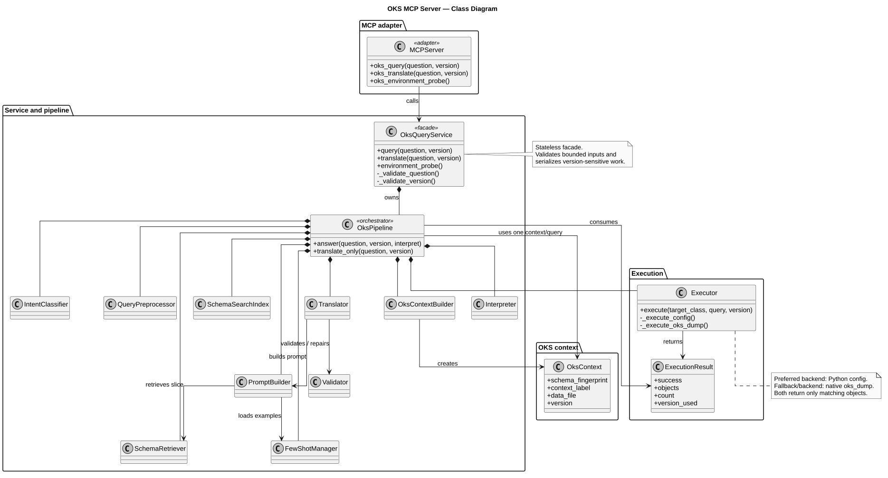
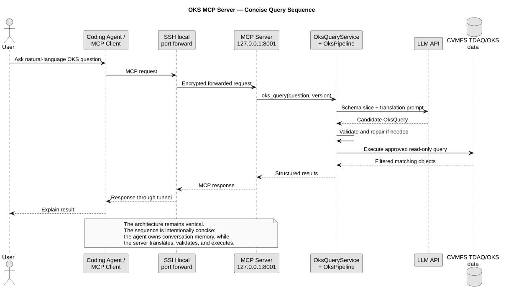
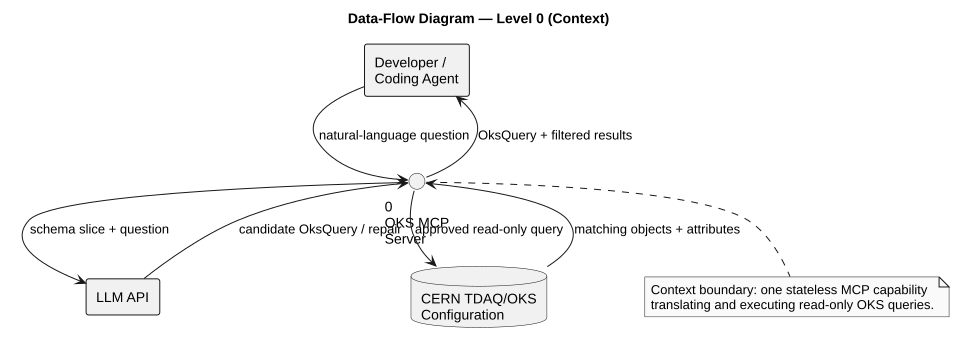
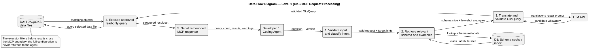
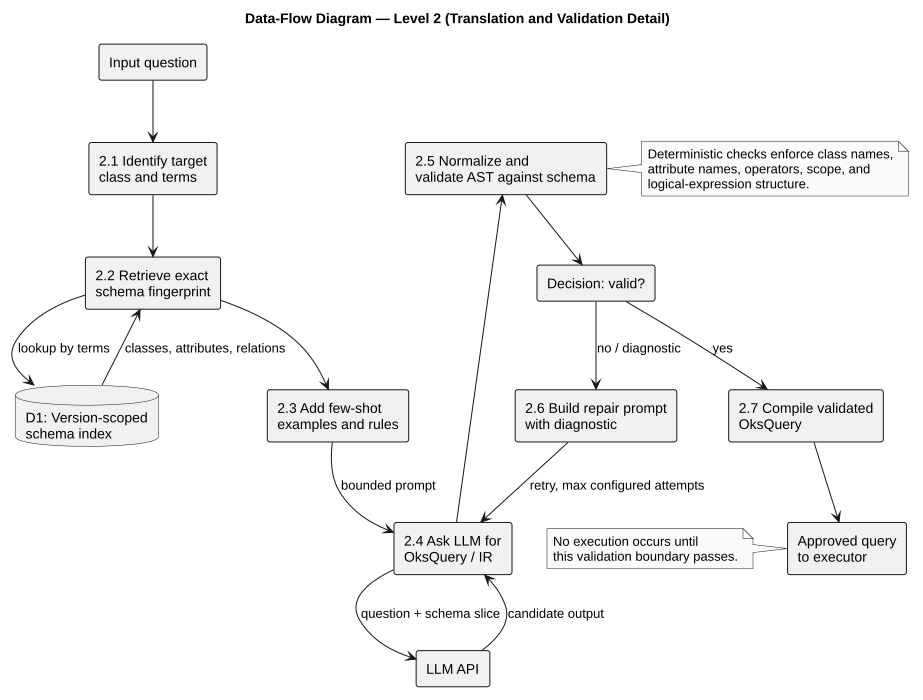

# OKS MCP System-Design Diagrams

This document adds the diagrams requested for the final report. They describe
the implemented stateless MCP server, its real Python components, and the
private SSH deployment path. The diagrams are deliberately monochrome: no
decorative icons, emojis, cloud-provider services, or invented databases are
shown.

## Which diagrams are relevant?

All five are useful for this project:

| Diagram | What it explains |
| --- | --- |
| Use case | Who interacts with the system and what the MCP supports |
| Class | How the implemented Python modules collaborate |
| Sequence | What happens during one natural-language query |
| DFD level 0 | The system boundary and external data exchanges |
| DFD levels 1 and 2 | Internal data movement and the translation/validation safety boundary |

The DFDs do not show a conversation-memory database because memory belongs to
the consuming agent, not this stateless MCP server.

## Use-case diagram

Source: [`use_case.puml`](diagrams/use_case.puml)

## Class diagram

Source: [`class_diagram.puml`](diagrams/class_diagram.puml)

## Concise sequence diagram

Source: [`sequence_diagram.puml`](diagrams/sequence_diagram.puml)

## Data-flow diagrams

### DFD level 0 — context

Source: [`dfd_level_0.puml`](diagrams/dfd_level_0.puml)

### DFD level 1 — request processing

Source: [`dfd_level_1.puml`](diagrams/dfd_level_1.puml)

### DFD level 2 — translation and validation

Source: [`dfd_level_2.puml`](diagrams/dfd_level_2.puml)

## Report wording

The system accepts a natural-language question from a coding agent through a
private SSH-forwarded MCP endpoint. The server validates the request, retrieves
only the relevant OKS schema slice, obtains an OksQuery candidate from the
configured LLM, validates and repairs it against the exact schema, and then
executes the approved read-only query through Python `config` or native
`oks_dump`. Only filtered structured results are returned to the agent. The
agent, not the MCP server, maintains conversation history and resolves
follow-up questions.
